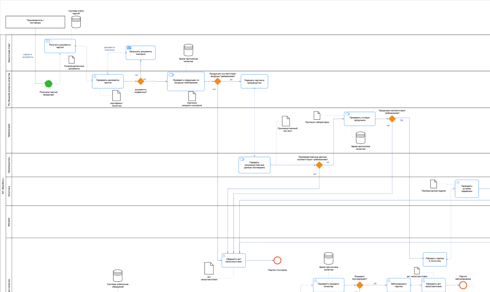
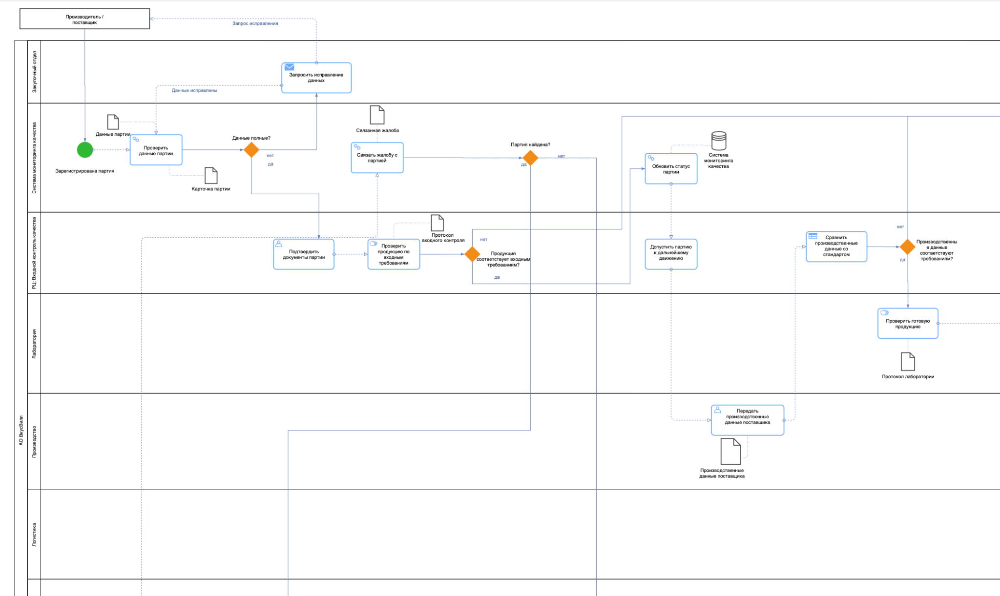

# Моделирование и оптимизация бизнес-процесса контроля качества — «ВкусВилл»

**Учебный аналитический проект | Бизнес-анализ • BPMN 2.0 • AS-IS / TO-BE**

## Задача

Исследовать процесс контроля качества продукции в розничной сети на основе доступных материалов, выявить потенциальные узкие места и предложить целевую модель, повышающую прослеживаемость партий, прозрачность принятия решений и скорость реакции на инциденты.

> **Ограничение исследования:** проект выполнен в учебных целях. Модель AS-IS реконструирована на основе открытых источников, отраслевой логики и аналитических допущений, а не внутренней документации компании. Модель TO-BE — предложение по улучшению; результаты не означают фактического внедрения во «ВкусВилл».

## Подход

1. Определение границ и участников процесса контроля качества.
2. Моделирование текущего состояния **AS-IS** в BPMN.
3. Анализ передач ответственности, проверок, ручных операций и информационных разрывов.
4. Проектирование целевого состояния **TO-BE** с единой карточкой партии/инцидента и связью между этапами контроля.
5. Сопоставление моделей, качественная оценка потенциальных эффектов, рисков и условий внедрения.

Дополнительно в исходном исследовании использовались **SIPOC, VAD, RACI, KPI, анализ рисков и подходы к управлению изменениями**.

## BPMN AS-IS — текущее состояние (реконструкция)

[Часть 2](diagrams/as-is-02.png) · [Часть 3](diagrams/as-is-03.png)

Модель описывает последовательность контроля партии на распределительном центре, решения о дополнительной проверке, дальнейшее движение продукции и обработку сообщений о дефектах.

## BPMN TO-BE — предлагаемая целевая модель

[Часть 2](diagrams/to-be-02.png) · [Часть 3](diagrams/to-be-03.png)

Ключевая проектная идея — единая карточка качества партии/инцидента, связывающая сведения о поставщике, партии, контрольных процедурах, логистике, торговой точке, жалобах и корректирующих действиях. Это концептуальное предложение, а не описание уже существующей ИТ-системы.

## Что демонстрирует проект

- Моделирование сквозных процессов в нотации BPMN.
- Анализ текущего состояния и проектирование улучшений AS-IS / TO-BE.
- Выявление информационных разрывов и точек передачи ответственности.
- Связь процессных изменений с метриками, рисками и организационными условиями внедрения.

## Материалы

- [`diagrams/`](diagrams/) — шесть BPMN-диаграмм для быстрого просмотра.
- [`source/presentation.pptx`](source/presentation.pptx) — исходная презентация исследования.
- [`source/research-report.docx`](source/research-report.docx) — полный учебный отчёт с обоснованием и приложениями.

## Контекст

Проект по дисциплине «Моделирование и анализ бизнес-процессов» образовательной программы «Бизнес-информатика» НИУ ВШЭ. Исследование выполнено в составе учебной проектной команды; описание не приписывает все командные результаты одному участнику.
